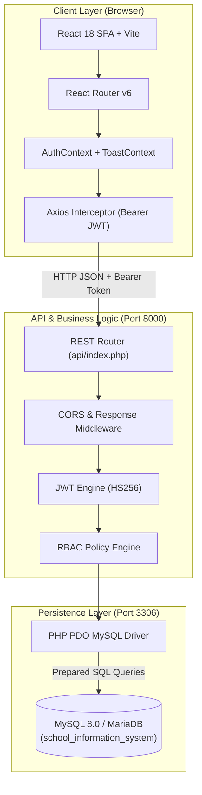

# ApexSIS — Technical Architecture Manual & Data Dictionary

This document details the engineering specifications, architectural design, database dictionary, and API reference for the **ApexSIS Enterprise School Information System**.

---

## 1. System Architecture Overview

ApexSIS follows a decoupled **Client-Server Architecture** utilizing a Single Page Application (SPA) frontend and a stateless RESTful PHP backend.

---

## 2. Technology Stack

### Frontend Stack
- **Framework:** React 18.3+ with Vite 8.x
- **Styling & UI:** Tailwind CSS 3.4+, PostCSS, Autoprefixer
- **Icons:** Lucide React + custom SVG icons (`PesoSign.jsx`)
- **Data Visualizations:** Recharts (Revenue analytics, Enrollment charts)
- **HTTP Client:** Axios with dynamic request/response interceptors
- **Typography:** Plus Jakarta Sans & Inter font families

### Backend Stack
- **Runtime:** PHP 8.0 - 8.3 (Built-in Web Server / Apache)
- **Database Access:** PHP Data Objects (PDO) with strict parameterized prepared statements
- **Authentication:** Stateless JSON Web Token (JWT) signed with HMAC-SHA256
- **Password Security:** One-way BCrypt cryptographic hashing (`PASSWORD_BCRYPT`, cost 10)
- **Data Format:** RFC 8259 JSON with Unicode support (`JSON_UNESCAPED_UNICODE`)

### Persistence & Storage
- **Database Engine:** MySQL 8.0+ / MariaDB 10.4+
- **Table Storage Engine:** InnoDB (ensuring ACID transaction compliance)
- **Character Set:** `utf8mb4` with `utf8mb4_unicode_ci` collation
- **Foreign Keys:** Enabled with cascading deletions on composite entity profiles

---

## 3. Database Schema & Data Dictionary

The database consists of **32 core relational tables** normalized to Third Normal Form (3NF).

### 3.1 Identity & Security Tables

#### `users`
Stores system accounts, access levels, and credentials.
| Column | Type | Nullable | Key | Description |
|---|---|---|---|---|
| `id` | INT AUTO_INCREMENT | No | PK | Unique user primary identifier |
| `username` | VARCHAR(100) | No | UK | Login username |
| `email` | VARCHAR(150) | No | UK | Primary user email address |
| `password_hash` | VARCHAR(255) | No | - | BCrypt hashed password |
| `role` | VARCHAR(50) | No | - | User role designation |
| `status` | ENUM('Active','Inactive','Suspended') | No | - | Account state (Default 'Active') |
| `avatar` | VARCHAR(255) | Yes | - | Profile avatar URL |
| `two_factor_enabled` | TINYINT(1) | No | - | 2FA toggle (0=Disabled, 1=Enabled) |
| `created_at` | TIMESTAMP | No | - | Account creation timestamp |
| `updated_at` | TIMESTAMP | No | - | Last modification timestamp |

#### `user_profiles`
Personal demographic details linked to user accounts.
| Column | Type | Nullable | Key | Description |
|---|---|---|---|---|
| `id` | INT AUTO_INCREMENT | No | PK | Record ID |
| `user_id` | INT | No | FK | References `users(id)` ON DELETE CASCADE |
| `first_name` | VARCHAR(100) | No | - | Given name |
| `middle_name` | VARCHAR(100) | Yes | - | Middle name |
| `last_name` | VARCHAR(100) | No | - | Family name |
| `gender` | ENUM('Male','Female','Other') | No | - | Gender identity |
| `birth_date` | DATE | Yes | - | Date of birth |
| `phone` | VARCHAR(50) | Yes | - | Primary phone number |
| `address` | TEXT | Yes | - | Residential street address |

#### `audit_logs`
Immutable audit trail capturing all system activities.
| Column | Type | Nullable | Key | Description |
|---|---|---|---|---|
| `id` | INT AUTO_INCREMENT | No | PK | Audit entry ID |
| `user_id` | INT | Yes | - | ID of user performing the action |
| `user_name` | VARCHAR(150) | No | - | Display name of the user |
| `role` | VARCHAR(100) | No | - | Role at time of action |
| `action` | VARCHAR(100) | No | - | Action name (e.g. USER_LOGIN, SUBMIT_GRADE) |
| `module` | VARCHAR(100) | No | - | Subsystem module affected |
| `record_id` | VARCHAR(50) | Yes | - | ID of the target record modified |
| `old_values` | TEXT | Yes | - | JSON serialized previous state |
| `new_values` | TEXT | Yes | - | JSON serialized updated state |
| `ip_address` | VARCHAR(50) | Yes | - | Originating IP address |
| `user_agent` | TEXT | Yes | - | Client browser user agent |
| `created_at` | TIMESTAMP | No | - | Timestamp of event |

---

### 3.2 Institutional Structure Tables

#### `campuses`
Campus site locations and administrative centers.
| Column | Type | Key | Description |
|---|---|---|---|
| `id` | INT AUTO_INCREMENT | PK | Campus ID |
| `name` | VARCHAR(150) | - | Official campus name |
| `code` | VARCHAR(50) | UK | Unique campus code (e.g., MAIN) |
| `address` | TEXT | - | Physical campus address |
| `phone` | VARCHAR(50) | - | Contact trunk line |
| `is_main` | TINYINT(1) | - | Main branch flag |

#### `buildings` & `rooms`
Physical spaces and instructional facilities.
- **`buildings`:** `id`, `campus_id` (FK), `name`, `code`, `floors_count`
- **`rooms`:** `id`, `building_id` (FK), `room_number`, `name`, `room_type` ('Lecture', 'Laboratory', 'Clinic', 'Library', 'Office', 'Auditorium'), `capacity`

#### `departments` & `programs`
- **`departments`:** `id`, `campus_id` (FK), `code`, `name`, `head_name`, `email`
- **`programs`:** `id`, `department_id` (FK), `code` (e.g. BSCS), `name`, `degree_type` ('Bachelor', 'Associate', 'Master', 'Doctorate', 'Senior High'), `total_units`

#### `subjects`
Curriculum course units and prerequisites.
| Column | Type | Description |
|---|---|---|
| `id` | INT AUTO_INCREMENT (PK) | Subject primary key |
| `department_id` | INT (FK) | References `departments(id)` |
| `code` | VARCHAR(50) UNIQUE | Course code (e.g. CS301) |
| `title` | VARCHAR(150) | Course title |
| `description` | TEXT | Syllabus overview |
| `lecture_units` | INT | Weekly lecture credits |
| `lab_units` | INT | Weekly laboratory credits |
| `credit_units` | INT | Total billable credit units |
| `prerequisite_codes` | VARCHAR(255) | Comma-delimited prerequisite subjects |

---

### 3.3 Student & Enrollment Lifecycle Tables

#### `students`
Student primary record and institutional identity.
| Column | Type | Key | Description |
|---|---|---|---|
| `id` | INT AUTO_INCREMENT | PK | Student database ID |
| `student_number` | VARCHAR(50) | UK | Formatted matriculation number (e.g. 2026-10001) |
| `user_id` | INT | FK | Associated login user ID |
| `program_id` | INT | FK | References `programs(id)` |
| `year_level_id` | INT | FK | References `year_levels(id)` |
| `section_id` | INT | FK | Assigned block section |
| `status` | ENUM(...) | - | Regular, Irregular, Graduating, etc. |
| `admission_date` | DATE | - | Official date of admission |
| `gpa` | DECIMAL(3,2) | - | Cumulative Grade Point Average |
| `qr_token` | VARCHAR(100) | UK | Unique cryptographic QR token |

#### `enrollments` & `enrollment_subjects`
- **`enrollments`:** Manages semester registration records, unit totals, financial assessment sums (`tuition_amount`, `misc_amount`, `total_amount`, `discount_amount`, `net_amount`, `paid_amount`, `balance_amount`), enrollment status, and official Certificate of Registration number (`cor_number`).
- **`enrollment_subjects`:** Maps enrolled subjects to specific class schedule slots.

#### `grades`
Modular grade components and approvals.
| Column | Type | Description |
|---|---|---|
| `written_works` | DECIMAL(5,2) | Written tasks assessment score (30%) |
| `performance_tasks`| DECIMAL(5,2) | Practical / laboratory score (50%) |
| `quarterly_exam` | DECIMAL(5,2) | Major term examination score (20%) |
| `prelim_grade` | DECIMAL(5,2) | Periodic prelim grade computation |
| `midterm_grade` | DECIMAL(5,2) | Periodic midterm grade computation |
| `final_grade` | DECIMAL(5,2) | Official final composite grade |
| `remarks` | ENUM | 'Passed', 'Failed', 'Incomplete', 'Dropped' |
| `status` | ENUM | 'Draft', 'Submitted', 'Approved', 'Locked' |

---

### 3.4 Finance, Operations & Campus Services

- **`invoices` & `payments`:** Official billing ledger. Tracks payments with official receipt (`or_number`), payment method (Cash, GCash, Maya, Bank Transfer, Check), cashier identifier, and electronic reference numbers.
- **`scholarships` & `student_scholarships`:** Academic and merit discount allocations.
- **`library_books` & `library_borrowings`:** ISBN registry, shelf location, loan durations, return tracking, and overdue fine calculation.
- **`clearances`:** Multi-signatory clearance status across 6 institutional offices (Registrar, Accounting, Library, Guidance, Clinic, Department Head).
- **`admissions`:** Applicant inquiries, entrance exam evaluations, and 1-click matriculation conversions.
- **`clinic_records` & `guidance_records`:** Medical consultations, triage logs, psychological counseling case files.
- **`inventory_items` & `hr_employees`:** Institutional fixed assets, depreciation, and academic faculty/staff roster.
- **`registrar_documents` & `qr_verifications`:** Digital verification portal for transcripts, certifications, and credentials.

---

## 4. API Endpoints Reference

All requests must include `Content-Type: application/json`. Protected endpoints require header:
`Authorization: Bearer <token>`

| Method | Route | Description | Auth Required |
|---|---|---|---|
| `POST` | `/api/auth/login` | Authenticate user & return JWT token | No |
| `GET` | `/api/auth/me` | Fetch authenticated user profile & permissions | Yes |
| `POST` | `/api/auth/switch-role` | Demo tool to switch active role instantly | Yes |
| `GET` | `/api/students` | Retrieve student directory with search filters | Yes |
| `POST` | `/api/students` | Enroll or matriculate a new student | Yes (Admin/Registrar) |
| `GET` | `/api/students/{id}` | Complete 360° student dossier | Yes |
| `GET` | `/api/grades` | Query student academic grades | Yes |
| `POST` | `/api/grades` | Encode and calculate component grades | Yes (Faculty) |
| `PUT` | `/api/grades/{id}` | Approve or lock final grades | Yes (Admin/Registrar) |
| `GET` | `/api/finance/invoices` | List student statements of account | Yes |
| `POST` | `/api/finance/payments`| Process payment & issue Official Receipt | Yes (Accountant) |
| `GET` | `/api/clearances` | Fetch departmental clearance roster | Yes |
| `PUT` | `/api/clearances/{id}`| Sign off on departmental clearance | Yes (Authorized Role) |
| `GET` | `/api/library/books` | Search catalog by title/ISBN | Yes |
| `POST` | `/api/library/loans` | Check out book & create loan schedule | Yes (Librarian) |
| `GET` | `/api/audit-logs` | Query chronological system audit trail | Yes (Admin) |

---

## 5. Security Architecture

1. **SQL Injection Defense:** All queries utilize strict PDO prepared statements with positional parameters. No raw user string interpolation.
2. **Cross-Origin Resource Sharing (CORS):** Dynamic origin whitelist validating incoming `HTTP_ORIGIN` against allowed local network hosts.
3. **Cross-Site Scripting (XSS):** React auto-escapes all JSX bindings. Output JSON is formatted with `JSON_UNESCAPED_UNICODE` while preventing tag execution.
4. **Token Security:** JWT tokens carry an explicit `iat` (issued-at) and `exp` (7-day expiration) timestamp, signed using a secure 256-bit institutional key.
